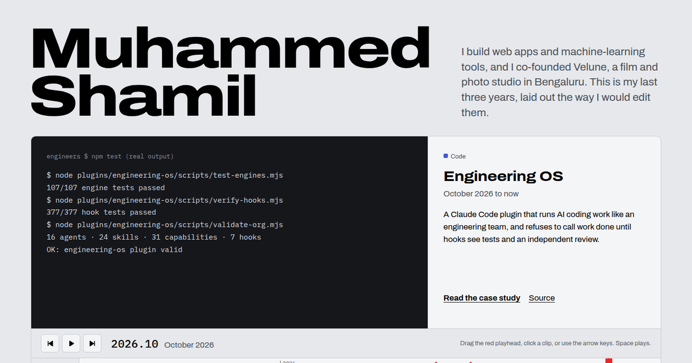

# Muhammed Shamil – portfolio

[](https://github.com/shxamill/portfolio/actions/workflows/ci.yml)

My personal site: **https://shxamill.vercel.app**



The homepage is a small video editor whose timeline is my career. Clips on the Code, Studio, Courses and Degree tracks are real projects, jobs and courses; drag the red playhead (or use the arrow keys, or press Space to play) and the viewer shows that moment. Each major project has a case study, and the fake news case study runs my trained model in the browser.

## How it is built

- [Astro](https://astro.build), static output, no UI framework. The editor and the model demo are small vanilla TypeScript scripts.
- Archivo (variable width) and IBM Plex Mono, self-hosted with Fontsource.
- All timeline content lives in `src/data/timeline.ts`; case studies live in `src/data/work.ts`.
- The fake news model is the scikit-learn TF-IDF + logistic regression model from [shxamill/fake_news](https://github.com/shxamill/fake_news), exported to `public/models/fakenews.json` and re-implemented in `src/lib/fakenews.js`. It matches the Python probabilities to four decimal places.

## Run it

Node 22.23.4 or later (Node 24 LTS recommended).

```bash
npm ci
npm run dev      # http://localhost:4321
npm run build    # static site in dist/
```

## Edit the timeline

Add an entry to `clips` in `src/data/timeline.ts` with a track, `start`/`end` months (`YYYY-MM`) and a media item (`image`, `video`, `terminal` or `card`). Overlapping clips on a track are packed into extra lanes automatically.

## License

The code is [MIT licensed](LICENSE). Photographs, videos, screenshots and client work under `src/assets/media` and `public/media` belong to Muhammed Shamil, Velune Creative Studio or the respective clients and are not covered by the MIT License.
